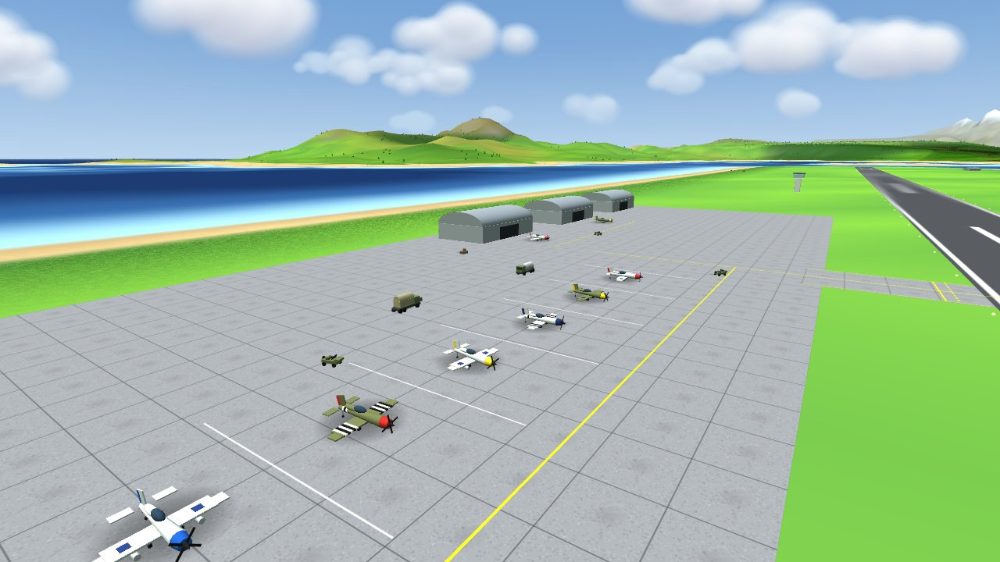
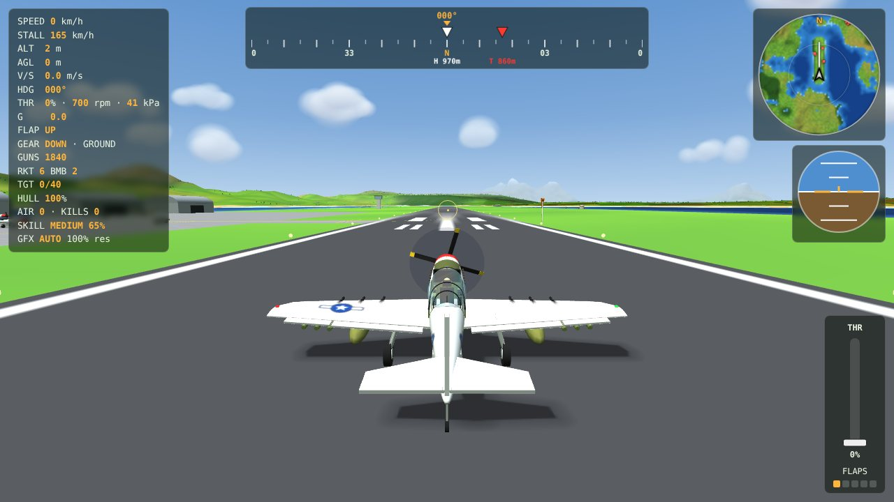
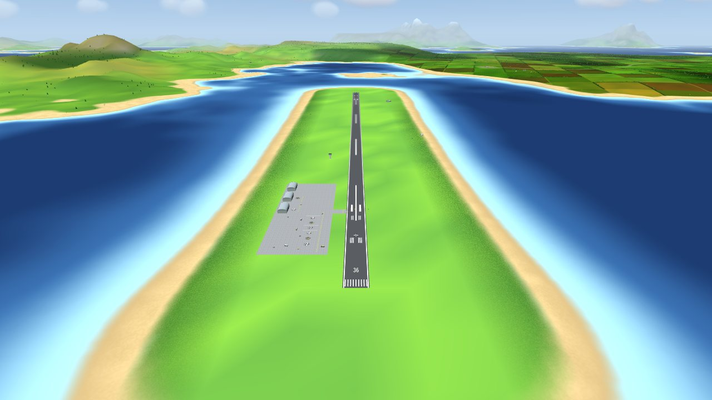

# P-51D Mustang Flight Simulator

**A casual-to-hardcore P-51D sim in a single offline HTML file.**
Take off, land on the ILS, strafe convoys, bomb buildings and dogfight, on your keyboard, a gamepad or your phone.

### [Play it in your browser](https://github.mrrat.org/p51-mustang-fs/)

by [MrRat Gaming](https://github.mrrat.org/) &nbsp;·&nbsp; [Discord](https://discord.gg/FybAhsxQHZ)

## Why you might like it
- **Fun first.** It flies like a P-51D (440 mph level, 500 mph dive) but stays casual. Realism is optional and switched on piece by piece.
- **One file, works offline.** `index.html` has everything, including three.js. No installs, no accounts, no network needed after the page loads.
- **Plays everywhere.** Desktop keyboard, gamepad, or phone and tablet with tilt controls and touch. Add it to your phone's home screen to use it like an app.
- **Looks good.** Rolling islands, beaches, fields and hedgerows, wind-swayed trees, clouds with shadows, day and night, and a detailed cockpit.

## What you can do
| | |
|---|---|
| **Free flight** | Explore the whole island chain, with a minimap and path guide. |
| **Trainers** | Takeoff, Landing (with ILS), Dogfighting, Building Bombing, Convoy Strafing, each with a visible flight path; plus coached aerobatics: Barrel Roll, Immelmann Turn, Split S, Wingover, Low Yo-Yo and High Yo-Yo (the coaching adapts to Hardcore mode). |
| **Combat** | Machine guns, rockets and bombs. Enemies come in Low (40%), Medium (65%) and Hard (100%) performance. |
| **Weather and time** | Pick your clock, dawn to night, and clear, cloud, fog or rain. |
| **Photo mode** | Press **F9** for a free camera. Drag to look, right-drag to pan, wheel to dolly, Ctrl+wheel to zoom. Save JPG snapshots. |
| **Graphics** | Auto, Low, Medium and High, so it runs on a phone and looks good on a PC. |

## Built from the original documents
The aircraft is modelled on the real P-51D. We built the airframe and tuned the flight model against our copies of the original factory blueprints (the three-view general arrangement with its area table, the fuselage stations, the wing, tail and landing gear drawings) and the P-51D flight-characteristics manual (stall speeds, flap and redline limits, load factors, glide and approach speeds). We matched them as closely as the documents and a browser game allow: dimensions, areas and stations follow the drawings, and the performance is checked against the published figures with repeatable tests (`P-51_Mustang_FS_perf_test.py` for climb, top speed, cruise and glide, and `P-51_Mustang_FS_smoke_test.py` for the rest). It is a game, so a few things stay approximate. The About page lists every item, what the real aircraft does, what this simulator does, and how close it is.

## Hardcore mode (optional)
Open **Settings** and use the master switch, then pick what you want. Each option has its own switch:
engine gauges and overheating, fuel and weight and balance, air density and the supercharger, damage, **working trim tabs** (elevator, rudder and aileron; keyboard and controller), and weather effects such as **wind, turbulence, wet runways (hydroplaning) and icing**. The About page compares the sim against the real P-51D and marks what each option brings closer.

## Controls
| Action | Keyboard | Gamepad |
|---|---|---|
| Pitch | `W` / `S` or arrows | Right stick |
| Roll | `A` / `D` or arrows | Right stick |
| Rudder | `Q` / `E` | LB / RB |
| Throttle | `Shift` up, `Ctrl` down | D-pad up / down |
| Flaps | `F` down, `V` up | D-pad right / left |
| Gear | `G` | A |
| Brakes | `B` (hold) | B |
| Guns | `Space` (hold) | RT |
| Rocket / bomb | `R` / `Z` | LT / X |
| Camera (chase / cockpit) | `C` | Y |
| Pause menu | `P` or `Esc` | Start |
| Manual (About, Controls, Operations) | `I` | |
| Trim (Hardcore) | `[` `]` pitch, `,` `.` rudder, `;` `'` aileron, `Backspace` centre | Hold Back + D-pad / LB / RB, Back + A centres |
| Photo mode | `F9` | |
| Path guide / ILS | `L` | |
| Minimap and zoom | `O`, `-`, `=` | |
| Graphics, sound | `N`, `U` | |

The in-game **Controls** tab always lists the full, current bindings, including phone controls.

## Run it yourself
Download `index.html` and open it in a modern browser. To host your own copy, publish the repo with GitHub Pages (Settings, Pages, deploy from `main` / root).

Built with [three.js](https://threejs.org/) r128 (MIT), inlined in the file.

## License
Free for noncommercial use under the [PolyForm Noncommercial License 1.0.0](https://polyformproject.org/licenses/noncommercial/1.0.0). Commercial use needs written permission. See [`LICENSE`](LICENSE).
