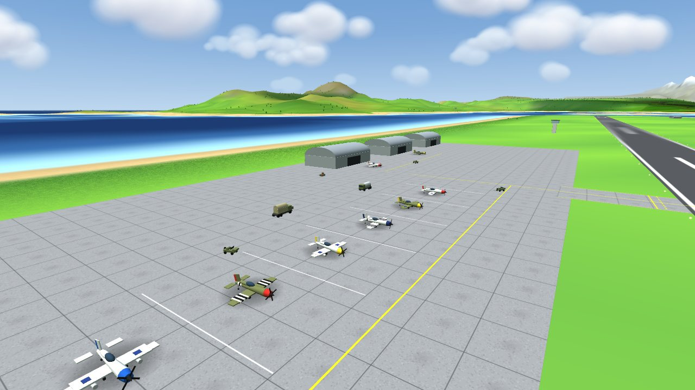
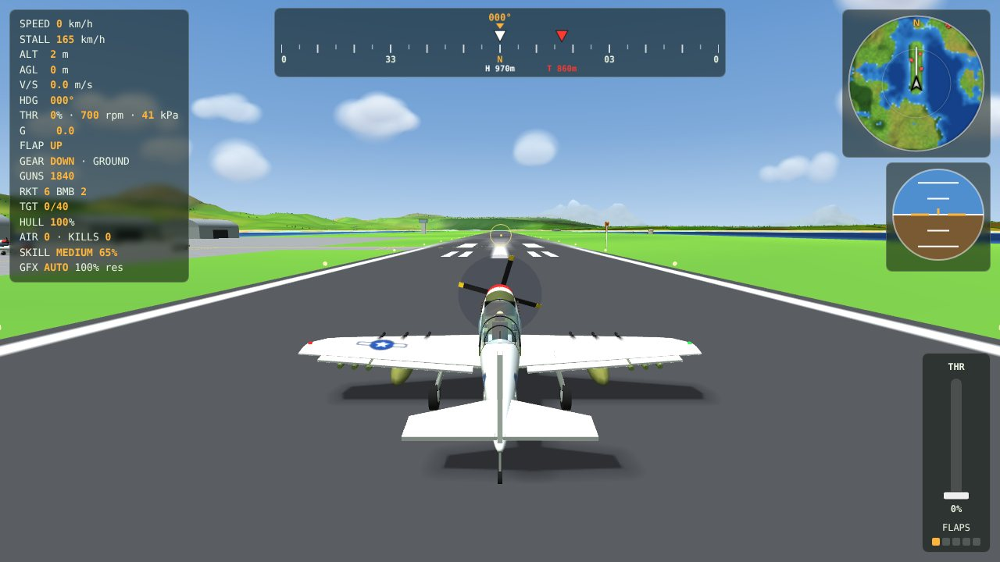
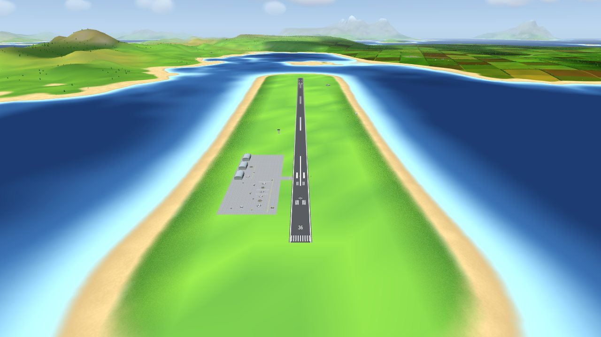

# P-51D Mustang Flight Simulator

**A P-51D Mustang flight sim in a single offline HTML file.**
Fly over a World War II South Pacific island chain, learn to take off, land and navigate, then strafe convoys, bomb targets and dogfight.

### [Play it in your browser](https://github.mrrat.org/P51-Mustang-FS/)

by [MrRat Gaming](https://github.mrrat.org/) &nbsp;·&nbsp; [Discord](https://discord.gg/FybAhsxQHZ)

## About

You fly a North American P-51D Mustang from a small airfield on a Pacific island. It handles like the real aircraft but stays easy to fly, and you can switch on realistic systems (engine, fuel, damage, weather) when you want more of a challenge.

- **One file, works offline.** `index.html` contains everything, including three.js. After the page loads you need no network, install or account.
- **Plays anywhere.** Keyboard, gamepad, or phone and tablet with tilt and touch controls. Add it to your home screen to use it like an app.
- **Guided training.** A green ring shows the path a test pilot flew, so you can learn each manoeuvre by following it.

## How to play

1. Open the [game](https://github.mrrat.org/P51-Mustang-FS/) (or `index.html` from this repo) in a modern browser.
2. Press **Free flight** to start, or press `P` / `Esc` and open the **Missions** tab to pick a guided mission.
3. **Take off:** raise the throttle to full (`Shift`). At about 190 km/h (about 120 mph) ease back on the stick, then raise the gear (`G`).
4. **Fly:** pitch with `W` / `S`, roll with `A` / `D`, and use `Q` / `E` for rudder. Press `C` to switch between chase and cockpit views.
5. **Land:** line up with the runway, lower the gear and flaps, keep a gentle descent, and touch down at low speed. Stop with the throttle at idle to repair and rearm.
6. **Follow the green ring (training missions):** keep the white flight-path marker inside the ring. Press `L` to show or hide the guide.

### Missions

| Mission | What you do |
|---|---|
| Takeoff / Landing | Fly the guided departure and approach. |
| ADF Navigation | Find the island airfield with the radio compass, then land. |
| Convoy strafing | Attack a convoy with guns and rockets, then come around for another pass. |
| Building bombing | Hit buildings with bombs. |
| Aerobatics | Barrel roll, Immelmann, Split S, Wingover, Low Yo-Yo and High Yo-Yo. |
| Free flight | Explore the islands, ports and airbases. Enemies come in Low, Medium and Hard difficulty. |

### Controls

| Action | Keyboard | Gamepad |
|---|---|---|
| Pitch | `W` / `S` or arrows | Right stick |
| Roll | `A` / `D` or arrows | Right stick |
| Rudder | `Q` / `E` | LB / RB |
| Throttle | `Shift` up, `Ctrl` down | D-pad up / down |
| Flaps | `F` down, `V` up | D-pad right / left |

Press `I` for the manual, which lists all in-game controls including controller and phone.

## Features

- **A large world.** Islands, beaches, fields, villages and roads stream in as you fly, with open sea beyond the mapped land.
- **Combat.** Machine guns, rockets and bombs. Optional sight rings for each (Settings, Sight rings); the rocket and bomb rings start off.
- **Ground fire.** Enemy bases have anti-aircraft guns and searchlights, and the port has an escort ship. You can switch it off in Settings.
- **Weather and time of day.** Dawn to night; clear, cloud, rain, thunderstorm and fog.
- **Photo mode.** Free camera and JPG snapshots.
- **Graphics options.** Auto, Low, Medium and High, so it runs on a phone and looks good on a PC.

### Hardcore mode (optional)

Open **Settings** and turn on the master switch, then choose what you want: engine gauges and overheating, fuel and balance, air density and the supercharger, damage, working trim tabs, and weather effects such as wind, turbulence, wet runways and icing.

## Accuracy

The airframe and flight model are based on the original P-51D drawings and flight-characteristics manual, and the performance is checked against the published figures. It is still a game, so some things are approximate. The in-game **About** page lists each item, what the real aircraft does and how close the sim comes.

Repeatable tests are in this repo: `P-51_Mustang_FS_perf_test.py` (climb, top speed, cruise and glide) and `P-51_Mustang_FS_smoke_test.py` (everything else). `P-51_Mustang_FS_Briefing_Map.pdf` is a printable map.

## Run your own copy

Download `index.html` and open it in a browser. To host it, publish the repo with GitHub Pages (Settings, Pages, deploy from `main` / root).

## License

Free for noncommercial use under the [PolyForm Noncommercial License 1.0.0](https://polyformproject.org/licenses/noncommercial/1.0.0). Commercial use needs written permission. See [`LICENSE`](LICENSE).

Built with [three.js](https://threejs.org/) r128 (MIT), included in `index.html`.
